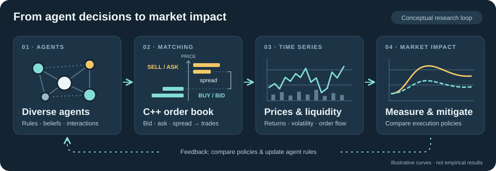

  

<h1 align="center">Yuito HASEGAWA 長谷川結音</h1>

  <strong>Artificial markets · Financial time series · Market microstructure</strong> 
  From individual trading decisions to collective market behavior.

  <a href="https://yuitokyouni.github.io/myhp/">Website</a> ·
  <a href="https://yuitokyouni.github.io/myhp/abm/">ABM playground</a> ·
  <a href="https://www.linkedin.com/in/yuitokyouni/">LinkedIn</a> ·
  <a href="mailto:yuitokyouni@g.ecc.u-tokyo.ac.jp">Email</a>

I'm a **master's student (M1) at The University of Tokyo**, in the Department of Human and Engineered Environmental Studies, Graduate School of Frontier Sciences — Complex Systems Simulation Lab (Chen Lab).

I study artificial financial markets through **agent-based modeling, C++ order-matching simulations, and financial time-series analysis**. I'm interested in how trading rules and interactions between agents shape liquidity, and how we can measure and mitigate market impact.

東京大学大学院 新領域創成科学研究科 人間環境学専攻 修士課程。金融時系列の分析、C++ による約定アルゴリズムの研究、ABM を用いたマーケットインパクトの測定・抑制に取り組んでいます。

## Inside my research

  

*Amber = sell / ask; mint = buy / bid. Order-book prices increase upward. The illustrations are conceptual; the curves do not represent measured results.*

| Theme | What I want to understand |
| --- | --- |
| **Agent-based markets** | How do heterogeneous trading strategies and interactions produce collective market behavior? |
| **Order matching & execution** | How do order-matching rules and execution strategies affect trades and liquidity? I explore these mechanisms with C++. |
| **Financial time series** | What can returns, volatility, and order flow tell us about the mechanisms behind market dynamics? |
| **Market impact** | How can we measure the price response to trading, and use simulated markets to investigate ways to reduce it? |

### Questions I'm exploring

- **Liquidity under stress:** How do investor populations differ in replenishing or withdrawing liquidity under selling pressure?
- **Correlated decisions:** How does similarity in agents' decisions affect liquidity resilience, even when the distribution of individual forecasting proficiency is held fixed?
- **Reproducible experiments:** How can we compare models and interventions while keeping assumptions, random seeds, and outputs traceable?

## Selected projects

| Project | What it does |
| --- | --- |
| [financial-abm-lab](https://github.com/yuitokyouni/financial-abm-lab) | A research workspace for financial-market agent-based models, reusable model implementations, and reproducible experiments and analysis. |
| [lobcore](https://github.com/yuitokyouni/lobcore) | A C++20 limit order book and discrete-event market simulation core, with Python bindings for defining agent behavior and running experiments. |
| [Sieve](https://github.com/yuitokyouni/sieve) | A simulation validation workbench for examining financial time series through stylized-fact diagnostics, offline reports, and verifiable evidence bundles. |

**[Step inside an artificial market →](https://yuitokyouni.github.io/myhp/abm/)**

Explore Cont–Bouchaud, Lux–Marchesi, and the Minority Game in my browser-based ABM playground.

## Background

- **Tools I use for research:** Python, C++, SQL
- **Modeling:** Agent-based models, artificial markets, and simulation-based analysis
- **Undergraduate background:** Integrated Sciences at The University of Tokyo; thesis on new hole transport materials for perovskite solar cells
